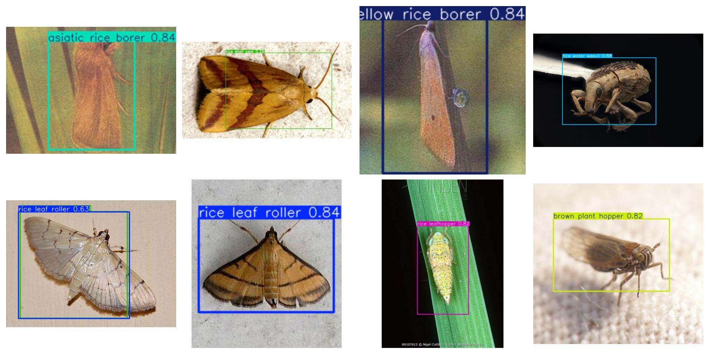
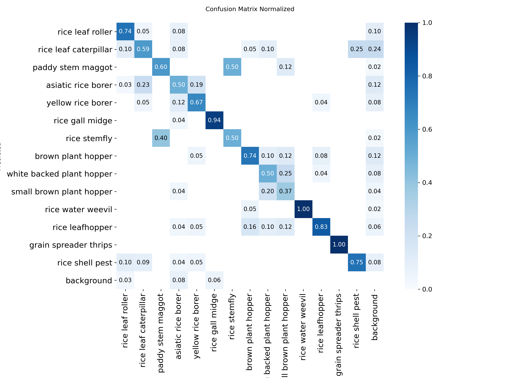
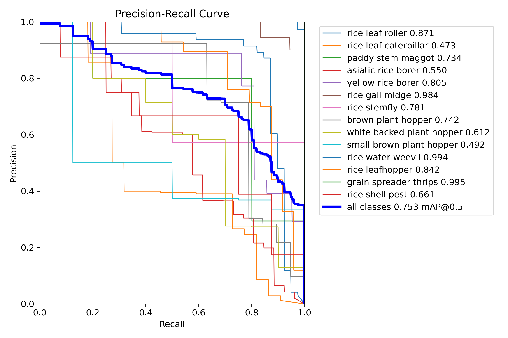
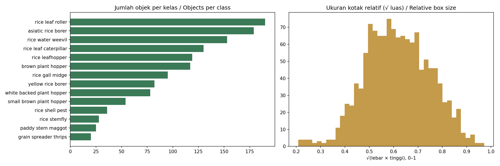

# Rice Pest Detection with YOLOv8

Object detection of **14 rice pest species** from the public **IP102** dataset using **YOLOv8**,
comparing a lightweight model (YOLOv8n) with a larger one (YOLOv8s) for field-deployable pest monitoring.

*Deteksi 14 jenis hama padi dari dataset publik IP102 menggunakan YOLOv8, dengan membandingkan model ringan
(YOLOv8n) dan model yang lebih besar (YOLOv8s) untuk pemantauan hama di lapangan.*

## Results / Hasil
Validation on the IP102 rice subset (1011 training images, 237 test images, image size 640, 50 epochs).

| Model | Parameters (M) | Precision | Recall | mAP@0.5 | mAP@0.5:0.95 | Inference (ms/img) | Size (MB) |
|---|---|---|---|---|---|---|---|
| yolov8n | 3.0 | 0.636 | 0.781 | 0.753 | 0.458 | 4.0 | 6.2 |
| yolov8s | 11.1 | 0.669 | 0.711 | 0.735 | 0.46 | 8.0 | 22.5 |

### Per-class AP@0.5
| Class (AP@0.5) | yolov8n | yolov8s |
|---|---|---|
| rice gall midge | 0.984 | 0.995 |
| rice water weevil | 0.994 | 0.993 |
| paddy stem maggot | 0.734 | 0.898 |
| rice leaf roller | 0.871 | 0.866 |
| rice stemfly | 0.781 | 0.845 |
| grain spreader thrips | 0.995 | 0.843 |
| rice leafhopper | 0.842 | 0.808 |
| yellow rice borer | 0.805 | 0.802 |
| brown plant hopper | 0.742 | 0.76 |
| rice shell pest | 0.661 | 0.659 |
| asiatic rice borer | 0.55 | 0.563 |
| white backed plant hopper | 0.612 | 0.541 |
| rice leaf caterpillar | 0.473 | 0.504 |
| small brown plant hopper | 0.492 | 0.207 |

| Confusion matrix | Precision-recall curve |
|---|---|
|  |  |

## Data / Dataset
- **IP102** (Wu et al., CVPR 2019), detection subset in Pascal VOC format, classes 1–14 (rice pests).
- Annotations converted to YOLO format with [`voc2yolo.py`](voc2yolo.py), keeping the official train/test split.
- The dataset is free for academic use and is **not redistributed** in this repository.

## Method / Metode
1. Convert Pascal VOC annotations to YOLO format (14 rice pest classes only).
2. Fine-tune COCO-pretrained YOLOv8n and YOLOv8s (transfer learning).
3. Evaluate with precision, recall, mAP@0.5, mAP@0.5:0.95, and inference time.

## Run it / Menjalankan
- **Notebook:** open `rice_pest_yolov8.ipynb` in Google Colab (T4 GPU) and run the cells in order.
- **Demo:** `pip install -r requirements.txt` then `python app.py`.

## Files
| File | Description |
|---|---|
| `rice_pest_yolov8.ipynb` | Full pipeline: data preparation, training, evaluation, demo |
| `voc2yolo.py` | IP102 VOC → YOLO converter for the rice subset |
| `app.py` | Gradio web demo |
| `weights/` | Trained weights (best checkpoints) |
| `results_summary.csv`, `results_per_class.csv` | Evaluation results |

## Acknowledgements
- Wu, X., Zhan, C., Lai, Y.-K., Cheng, M.-M., & Yang, J. (2019). IP102: A large-scale benchmark dataset for insect pest recognition. *CVPR*.
- [Ultralytics YOLOv8](https://github.com/ultralytics/ultralytics) (AGPL-3.0).

## License
Code is released under the **AGPL-3.0** license, following Ultralytics YOLOv8.

---
**Desi Susanti, S.Kom., M.Kom.** · [Portfolio](https://des1susanti.github.io/portofolio-v2/index.html) · [LinkedIn](https://www.linkedin.com/in/desi-susanti-70a7b831a/)
